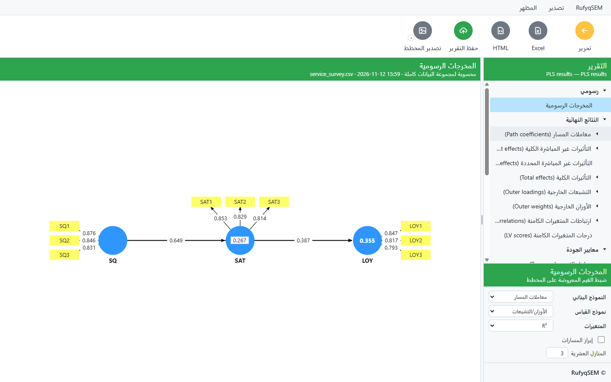
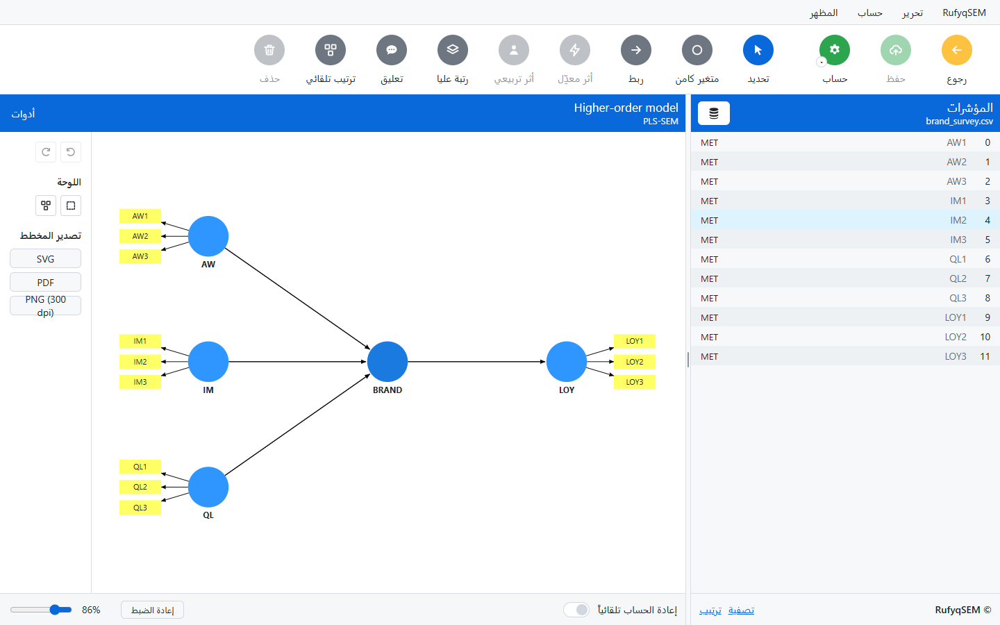
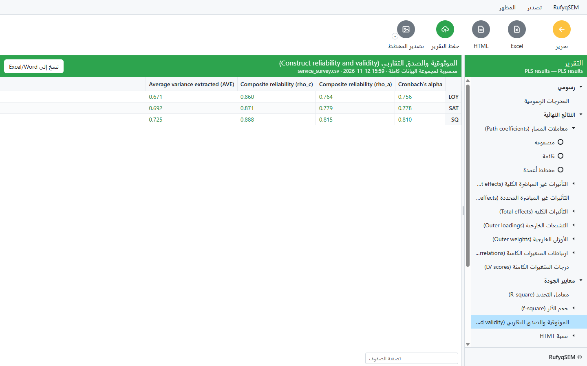
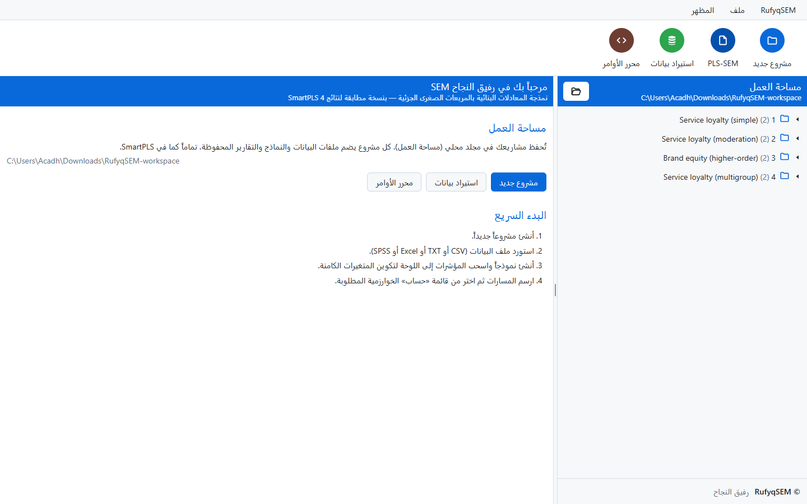

<div align="center">


# رفيق النجاح SEM · RufyqSEM

### برنامج عربي متكامل لنمذجة المعادلات البنائية بالمربعات الصغرى الجزئية (PLS‑SEM)

<p>


</p>

<a href="https://github.com/muhammedalkhalaf/RufyqSEM/releases/latest"><b>⬇️ تحميل أحدث نسخة</b></a>

</div>

---

## نظرة عامة

**رفيق النجاح SEM** تطبيق مكتبي لويندوز يُجري تحليل نمذجة المعادلات البنائية القائمة على المركّبات (PLS‑SEM) من أول البيانات الخام حتى التقرير النهائي، بواجهة عربية كاملة من اليمين إلى اليسار. صُمّم ليكون مألوفاً لمستخدمي SmartPLS من حيث سير العمل وأسماء المخرجات، مع محرّك حسابي مستقل تماماً تُطابق نتائجه المراجع المنشورة جدولاً جدولاً.

يناسب الباحثين وطلاب الدراسات العليا في الإدارة والتسويق والاقتصاد والعلوم الاجتماعية الذين يحتاجون أداة PLS‑SEM موثوقة بلغتهم، بلا قيود على عدد الحالات وبلا اشتراك.

<div align="center">

<br><sub>المخرجات الرسومية: معاملات المسار وR² والتحميلات معروضة مباشرة على المخطط.</sub>
</div>

---

## لماذا رفيق النجاح SEM؟

- **عربي أصيل** — كامل الواجهة والقوائم والتقارير من اليمين إلى اليسار، مع إمكانية التبديل إلى الإنجليزية.
- **نتائج مُتحقَّق منها** — المسارات والأوزان والتحميلات وR² وf² وQ² وHTMT وBootstrapping طُوبقت مع البرامج المرجعية إلى ثلاث منازل عشرية.
- **بلا قيود** — لا حدّ على عدد الحالات ولا على التصدير، بخلاف التراخيص الطلابية المقيّدة.
- **أمثلة جاهزة** — أربعة مشاريع نموذجية تظهر عند أول تشغيل لتبدأ فوراً.
- **يعمل دون إنترنت** — كل الحساب محلي على جهازك؛ لا تُرسَل بياناتك إلى أي خادم.

---

## المزايا بالتفصيل

### نموذج القياس
- متغيرات انعكاسية (Mode A) وتكوينية (Mode B).
- متغيرات من الرتبة العليا (Higher‑order) بالطرق الثلاث: المؤشرات المكررة، والمرحلتان المضمّنة، والمرحلتان المنفصلة.
- الموثوقية: ألفا كرونباخ، rho_a، rho_c، ومتوسط التباين المستخلص (AVE).
- الصدق التمييزي: نسبة HTMT، ومعيار فورنل‑لاركر، والتحميلات المتقاطعة.
- معاملات التضخم (VIF) للنموذجين الخارجي والداخلي.

### النموذج البنائي
- معاملات المسار والتأثيرات الكلية وغير المباشرة (العامة والمحددة).
- التعديل (Moderation) والوساطة المعدّلة بالطرق: المرحلتان، والمؤشرات الضربية، والتعامد.
- الأثر التربيعي، والميول البسيطة (Simple slopes).
- R² وR² المعدّل وحجم الأثر f² ومؤشرات الملاءمة (SRMR، d_ULS، d_G، NFI).

### الخوارزميات والتحليلات المتقدمة
- **PLS‑SEM** و**PLSc** (المتسق للنماذج العاملية).
- **Bootstrapping** (حتى 100000 عينة فرعية، فترات Percentile وBC وBCa) واستدلال الملاءمة بـ Bollen‑Stine.
- **Blindfolding** للصلاحية التنبؤية Q²، و**PLSpredict** وCVPAT.
- **تحليل متعدد المجموعات (MGA)** واختبار التبادل و**MICOM**.
- **FIMIX‑PLS** و**PLS‑POS** لعدم التجانس الكامن.
- **IPMA** و**NCA** و**CTA‑PLS** و**CB‑SEM** والانحدار الخطي ونماذج **PROCESS**.

### تجربة الاستخدام
- محرّر مخطط تفاعلي بالسحب والإفلات، وترتيب تلقائي للنموذج.
- محرّر أوامر نصي (Syntax) وتشغيل دفعي من سطر الأوامر.
- تصدير التقارير إلى Excel وHTML، وتصدير المخطط إلى SVG وPDF وPNG بدقة 300dpi.

---

## لمحة من البرنامج

<div align="center">

<br><sub>محرّر النموذج: اسحب المؤشرات من القائمة، وارسم المسارات، وكوّن متغيرات من الرتبة العليا — هنا نموذج عاكس‑تكويني.</sub>
<br><br>

<br><sub>التقرير: شجرة مخرجات منظّمة، ولكل جدول عرض مصفوفة وقائمة ومخطط أعمدة، مع تمييز لوني للقيم.</sub>
</div>

---

## الأمثلة الجاهزة

عند أول تشغيل تُضاف أربعة مشاريع نموذجية إلى مساحة العمل، ببيانات مُولَّدة أصلية جاهزة للحساب فوراً:

| المشروع | ما يوضّحه |
|---|---|
| **1 — النموذج البسيط** | وساطة: جودة الخدمة ← الرضا ← الولاء (مع تقرير PLS محفوظ) |
| **2 — التعديل** | أثر معدِّل (قيمة السعر) على مسار الرضا ← الولاء بطريقة المرحلتين |
| **3 — الرتبة العليا** | متغير من الرتبة العليا عاكس‑تكويني (مرحلتان منفصلة) |
| **4 — متعدد المجموعات** | النموذج نفسه مع متغير تجميع لمقارنة المجموعات (MGA) |

> البيانات في هذه الأمثلة مُولَّدة اصطناعياً خصيصاً لهذا البرنامج، وليست منقولة من أي مصدر آخر.

<div align="center">

<br><sub>مساحة العمل عند أول تشغيل: المشاريع النموذجية الأربعة جاهزة للفتح والحساب.</sub>
</div>

---

## التحميل والتثبيت

1. حمّل أحدث مثبّت من صفحة **[الإصدارات](https://github.com/muhammedalkhalaf/RufyqSEM/releases/latest)**: `RufyqSEM-Setup-1.2.3.exe`.
2. شغّل المثبّت. لا يحتاج صلاحيات مدير، ويُثبَّت لحسابك.
3. افتح البرنامج من قائمة ابدأ أو أيقونة سطح المكتب.

> عند أول تشغيل قد يُظهر Windows SmartScreen تنبيهاً لأن الملف غير موقّع بشهادة تجارية — اختر **«مزيد من المعلومات» ← «تشغيل على أي حال»**. تحقّق من سلامة الملف بالبصمة أدناه.

### التحقق من سلامة الملف

بعد التحميل، قارن بصمة SHA‑256 للملف بالقيمة المنشورة في صفحة الإصدار:

```powershell
Get-FileHash .\RufyqSEM-Setup-1.2.3.exe -Algorithm SHA256
```

إن اختلفت البصمة فالملف ليس النسخة الأصلية — لا تشغّله.

---

## متطلبات التشغيل

- **النظام:** Windows 10 أو 11 بنواة 64‑بت.
- **المساحة:** نحو 450 ميغابايت بعد التثبيت.
- **الذاكرة:** 4 غيغابايت فأكثر (يُنصح بـ 8 لتحليلات Bootstrapping الكبيرة).
- لا يتطلب تثبيت Python أو R أو أي أدوات أخرى.

---

## الترخيص والحماية من النسخ

هذا برنامج **ملكية خاصة** لصاحبه. يُسمح بتنزيله وتثبيته واستخدامه للأغراض البحثية والتعليمية، ويُمنع منعاً باتاً:

- إعادة توزيعه أو بيعه أو نشره تحت اسم آخر.
- تفكيكه أو عكس هندسته أو استخراج شيفرته أو إنتاج عمل مشتق منه.
- انتحال اسمه أو هويته البصرية.

تفاصيل الحقوق في ملف **[LICENSE](LICENSE)**. الشيفرة المصدرية غير منشورة؛ يُوزَّع البرنامج كمثبّت تنفيذي فقط، وبصمة SHA‑256 المنشورة تتيح التأكد من أصالة الملف وعدم العبث به.

---

<div align="center">

**تطوير: رفيق النجاح — Rufyq Elngeh**

جميع الحقوق محفوظة © 2026

</div>
